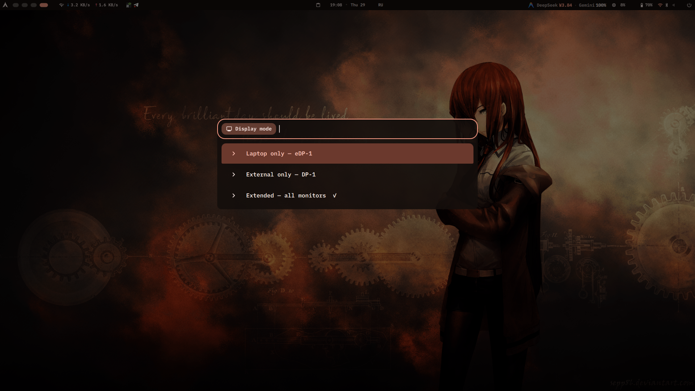
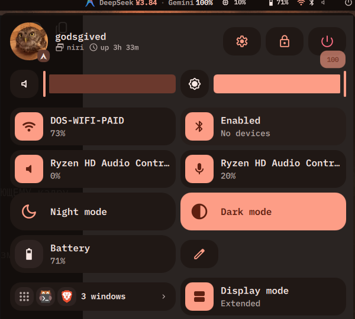

# Display Modes

A Win+P-style display switcher for [Dux Shell (DMS)](https://duxlabs.dev) on
[niri](https://github.com/YaLTeR/niri).

Pick **laptop only**, **external only**, or **extended** from one menu. The
extended layout is remembered, so going back to it restores your monitors
exactly where they were.



## Features

- **One picker for the three common setups** — laptop only, one external
  monitor only, or every connected monitor.
- **Remembers the extended layout** — position, mode, scale, transform and
  refresh rate.
- **Win+P shortcut** — a DMS-managed `Mod+P` binding, configurable or removable
  in the plugin settings. An existing binding is never overwritten.
- **Control Center tile and bar widget** — shows the current mode and switches
  with one click.
- **Launcher integration** — type `mon` in the launcher.
- **IPC** — `dms ipc call displayModes internal|external|extend|cycle|menu`.
- **English and Russian UI**, plus a localized picker that follows the session
  locale.



## Requirements

- Dux Shell 2.0.0 or newer
- niri
- `jq` and `bash`

The plugin is niri-only for now. Hyprland, Sway and other compositors are not
supported.

## Installation

From the plugin registry:

> Settings → Plugins → Browse → **Display Modes**, or
> `dms plugins install displayModes`

Manual installation:

```bash
git clone https://github.com/godsGived/dms-display-modes \
    ~/.config/dms/plugins/displayModes
dms restart
```

Then enable **Display Modes** in Settings → Plugins. Add the widget to a bar or
to the Control Center from the same settings page.

## Usage

| Action | How |
| --- | --- |
| Open the picker | `Mod+P` (configurable) |
| Control Center | Add the **Display Modes** tile |
| Bar | Add the widget and click it |
| Launcher | Type `mon` |
| IPC | `dms ipc call displayModes internal` |

Available IPC commands: `internal`, `external`, `extend`, `cycle`, `menu`.

The bundled script can also be used directly:

```bash
~/.config/dms/plugins/displayModes/scripts/display-modes current
~/.config/dms/plugins/displayModes/scripts/display-modes extend
```

## How it works

The plugin drives `niri msg output`:

- **Laptop only** and **External only** disable the other outputs and place the
  remaining one at `0,0`.
- **Extended** turns every connected output on and restores saved positions,
  scales and modes. If there is no saved layout, the built-in display is placed
  on the left and external monitors to the right.
- The extended layout is saved to
  `~/.local/state/dms-display-modes/layout.json` before switching to a
  single-monitor mode.

niri refuses overlapping output positions and silently auto-places instead, so
the script temporarily parks outputs to the right and verifies the final layout
before finishing.

## Settings

- **Picker shortcut** — default `Mod+P`; leave it empty to remove the binding.
  If the key is already used by another action, the plugin reports the conflict
  instead of replacing it.
- **Show mode name in the bar** — hides the text label and keeps only the icon.

## Limitations

- niri only; the plugin uses niri's output commands.
- Mirroring is not included. Use `wl-mirror` for that.
- A single picker can be open at a time; repeated presses are ignored while the
  menu is visible.

## License

MIT © 2026 godsGived
